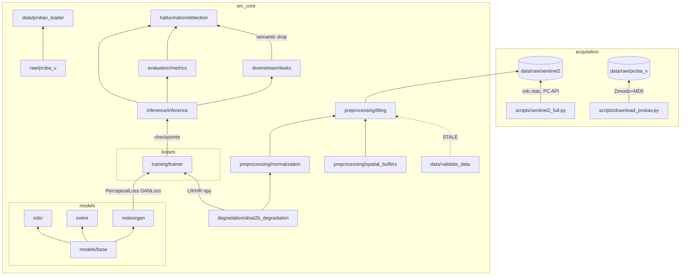

# PROJECT_DOCUMENTATION.md — MASTER2-A1 Full Codebase Audit

**Generated:** 2026-11-14 (read-only audit; the only file created is this document)
**Audited repository:** `C:\Users\stream\Desktop\m2 pfe\MASTER2-A1\` (canonical; git branch `master`, HEAD `c39ccac`)
**Audit method:** Static reading of every source, config, script, test, and documentation file. No code was executed, no image or dataset content was opened or decoded, nothing was modified. Dataset directories were inspected at directory/filename/manifest level only.
**Audience:** The project owner, for presentation and academic defense of the work.

---

## Table of Contents

1. [Executive Summary](#1-executive-summary)
2. [Project Identity, Goal & Research Context](#2-project-identity-goal--research-context)
3. [Repository Layout & File Inventory](#3-repository-layout--file-inventory)
4. [Version Control & Workspace State](#4-version-control--workspace-state)
5. [Data Acquisition & Datasets](#5-data-acquisition--datasets)
6. [Data Layer — `src/data/`](#6-data-layer--srcdata)
7. [Preprocessing & Normalization — `src/preprocessing/`](#7-preprocessing--normalization--srcpreprocessing)
8. [Degradation Modeling — `src/degradation/`](#8-degradation-modeling--srcdegradation)
9. [Model Architectures — `src/models/`](#9-model-architectures--srcmodels)
10. [Training Pipeline — `src/training/`](#10-training-pipeline--srctraining)
11. [Inference Pipeline — `src/inference/`](#11-inference-pipeline--srcinference)
12. [Evaluation Metrics — `src/evaluation/`](#12-evaluation-metrics--srcevaluation)
13. [Hallucination Detection — `src/hallucination/`](#13-hallucination-detection--srchallucination)
14. [Downstream Tasks — `src/downstream/`](#14-downstream-tasks--srcdownstream)
15. [Scripts & Automation — `scripts/`](#15-scripts--automation--scripts)
16. [Configuration System — `configs/`](#16-configuration-system--configs)
17. [Test Suite — `tests/`](#17-test-suite--tests)
18. [Research & Documentation Corpus](#18-research--documentation-corpus)
19. [Data Provenance & Reproducibility](#19-data-provenance--reproducibility)
20. [Technology Stack & Dependencies](#20-technology-stack--dependencies)
21. [Issues, Inconsistencies & Technical Debt](#21-issues-inconsistencies--technical-debt)
22. [Final Technical Summary](#22-final-technical-summary)

---

## 1. Executive Summary

**MASTER2-A1** is a Master 2 Computer Science / AI thesis project: *"Hallucination-Aware and Task-Driven Evaluation of Super-Resolution Methods for ALSAT-2B Satellite Imagery."* Because direct ALSAT-2B data access was blocked (the Algerian space agency portal `asal.dz` was unreachable — a documented, evidence-backed finding in `research/alsat2b_access.md`), the project pivoted (with documented methodology decisions, `docs/methodology_decisions.md`) to an S2-proxy design: **Sentinel-2 L2A imagery degraded through a Wald-protocol pipeline stands in for the target-resolution sensor, and PROBA-V serves as a real multi-sensor SR dataset.**

The repository contains a complete, tested, end-to-end scientific pipeline — acquisition → tiling → normalization → degradation → SR model training (EDSR / SwinIR / Real-ESRGAN) → inference → fidelity metrics + hallucination detection → downstream task evaluation → statistical analysis — with 24 Python modules in `src/`, 7 automation scripts, 6 YAML configs, 13 test files (245 test functions counted statically), and an extensive research/documentation corpus.

**Current pipeline stage (as of 2026-11-14, Phase 3):** full-scale Sentinel-2 acquisition is substantially progressed or in flight — 91 scene directories exist on disk across all 8 AOIs, with 23 full-run manifests in `data/metadata/sentinel2/full/`. PROBA-V is fully downloaded, MD5-verified, and extracted (58,202 PNGs). Tiling (`data/processed/sentinel2` is empty) and splitting (`data/splits/` is empty) have **not** been run yet. No SR training run has occurred on the real data (a Kaggle cloud template exists, since local training is CPU-only).

**Health assessment:** The codebase is in strong shape for its stage — normalization, tiling, degradation, models, metrics, hallucination detection, and downstream tasks all have passing tests (239 passing per session records; 245 collected statically). However, the audit found **~21 concrete issues** (Section 21), including two metric-implementation inconsistencies (duplicate/inconsistent ERGAS & SAM), a logic bug that makes the TUS metric trivially constant, an import-name mismatch that will crash the Kaggle training template, a data-leakage risk in the PROBA-V loader's split method that contradicts the project's own config, and several stale/superseded modules.

**Headline numbers (all verified this session):**

| Item | Value | Source |
|---|---|---|
| Git HEAD | `c39ccac`, branch `master` | `git rev-parse` |
| `src/` modules | 24 files, 300 function/class/method definitions | static count |
| Scripts | 7 files | directory listing |
| Configs | 6 YAML + 1 protocol template | directory listing |
| Tests | 13 files, 245 test functions (static count) | regex count |
| PROBA-V | 58,202 PNGs; MD5 `7101101c…b784`; 708,416,603 bytes | manifest + session record |
| Sentinel-2 | 91 scene dirs / 8 AOIs; 23 full manifests | directory + manifest listing |
| Trained models on real data | **None yet** (template only) | absence of checkpoints |

---

## 2. Project Identity, Goal & Research Context

### 2.1 Thesis framing

- **Title:** *Hallucination-Aware and Task-Driven Evaluation of Super-Resolution Methods for ALSAT-2B Satellite Imagery* (`AGENTS.md`, `README.md`).
- **Degree:** Master 2 Computer Science / Artificial Intelligence, Algeria.
- **Core research question family (from `research/final_research_questions.md`, digested):** Do super-resolution models hallucinate — i.e., generate plausible-looking but scientifically invalid detail — when upscaling satellite imagery, and does this harm downstream analysis tasks (segmentation, detection, change detection)?

### 2.2 Research questions (RQ1–RQ10, from the finalized set)

The repository documents ten research questions. Their intent (paraphrased faithfully from `research/final_research_questions.md` and `README.md`; exact wording lives in those files):

1. **RQ1** — How well do SR methods (EDSR, SwinIR, Real-ESRGAN) recover Sentinel-2 imagery degraded by a physically-motivated ALSAT-2B-like pipeline?
2. **RQ2** — What is the quantitative fidelity gap (PSNR/SSIM/SAM/ERGAS) between SR outputs and original reference imagery?
3. **RQ3** — Where and when do spectral hallucinations occur (SAM, NDVI violations, spectral-correlation deviation)?
4. **RQ4** — Where and when do structural hallucinations occur (wavelet high-frequency energy in homogeneous regions)?
5. **RQ5** — Where and when do textural hallucinations occur (GLCM entropy divergence)?
6. **RQ6** — Does SR-induced hallucination degrade downstream task performance (semantic task drops)?
7. **RQ7–RQ10** — Model comparison and robustness angles (per-model hallucination rates, degradation-parameter sensitivity, cross-region generalization, statistical significance of differences). *Note: the exact RQ7–RQ10 definitions vary between documents — see Issue #14 (Section 21).*

### 2.3 Hypotheses (H1–H10)

`research/final_hypotheses.md` defines ten falsifiable hypotheses (H1–H10), one per RQ, each stated with expected direction and a testable criterion (e.g., H: "GAN-trained Real-ESRGAN produces more spectral hallucinations than PSNR-oriented EDSR, measured by the hallucination taxonomy"). All are currently **untested** — no experimental results exist yet in the repository.

### 2.4 Methodology decisions log

`docs/methodology_decisions.md` records numbered decisions (**MD-xxx**), including the ALSAT-2B→Sentinel-2 proxy pivot, dataset selection (Sentinel-2 L2A 4-band @10 m via Planetary Computer; PROBA-V from Zenodo), split policy (temporal), and the decision to build fallback downstream models instead of depending on `segmentation-models-pytorch`. This is good scientific hygiene — the audit verified the log exists and is structured.

### 2.5 Key scientific design principles (established in code/docs)

- **Wald protocol** for sensor simulation: train the SR model to map a *simulated degraded* Sentinel-2 image to its *original* (as proxy ground truth), never mixing real sensors in a pair.
- **Train-split-only normalization statistics** (no leakage from val/test).
- **Hallucination taxonomy with four axes**: Spectral, Structural, Textural, Semantic — each with quantitative detectors and thresholds.
- **Task-driven evaluation**: fidelity metrics alone are insufficient; hallucination is defined by its *effect*.
- **Statistical rigor**: bootstrap confidence intervals and Friedman-style rank tests planned (with a documented inconsistency on bootstrap iteration count — see Issue #14).

### 2.6 Status distinction (per project rules in `AGENTS.md`)

Throughout this document: **implemented** = code exists in `src/` and is covered by tests; **planned** = defined in docs/configs but not yet executed; **mentioned-only** = appears in research notes without code. The audit explicitly labels each scientific method accordingly.

---

## 3. Repository Layout & File Inventory

### 3.1 Top-level layout (canonical repo `MASTER2-A1/`)

```
MASTER2-A1/
├── AGENTS.md                  # Agent instructions, project rules, phase plan
├── README.md                  # 444-line narrative: setup, RQ table, hypothesis table
├── PROJECT_UPDATE.md          # Permanent development history log
├── opencode.json              # Agent harness config (permissions reviewed §21)
├── .gitignore                 # Excludes data/, venv/, .git — see Issue #17
├── requirements.txt           # Pinned deps — see Issue #18 (drift)
├── requirements-cloud.txt     # Kaggle/GPU-variant deps
├── .env.example               # Placeholder env template (no real .env committed — verified)
├── src/                       # 24 Python files (library code)
├── scripts/                   # 7 automation scripts
├── configs/                   # 6 YAML configs + degradation config
├── tests/                     # 13 test files in 9 packages
├── experiments/protocols/     # kaggle_train_template.py
├── research/                  # ~20 research notes + paper database
├── docs/                      # Phase reports, methodology decisions, reproducibility
├── data/                      # raw / interim / processed / splits / metadata
├── notebooks/                 # EMPTY (scaffolding only)
├── results/                   # EMPTY (scaffolding only)
├── thesis/                    # EMPTY (scaffolding only)
└── venv/                      # Virtual environment (EXCLUDED from audit contents)
```

### 3.2 Complete `src/` inventory (24 files, 300 defs)

| Module | File | Role | Status |
|---|---|---|---|
| data | `probav_loader.py` | PROBA-V dataset loading (PNG, imgsets) | implemented (loader); split-method flagged §21 |
| data | `sentinel2_downloader.py` | Sentinel-2 download + tile/normalize | partially superseded by scripts/tiling (§21 #13) |
| data | `validate_data.py` | Tile/manifest validation | **stale** vs new tile-index format (§21 #12) |
| degradation | `alsat2b_degradation.py` | Wald-protocol degradation pipeline | implemented, tested |
| models | `base.py` | `BaseSRModel` abstract base | implemented |
| models | `edsr.py` | EDSR (PSNR-oriented SR) | implemented, tested |
| models | `swinir.py` | SwinIR (transformer SR) | implemented, tested |
| models | `realesrgan.py` | RRDBNet + discriminator + losses | implemented, tested |
| preprocessing | `preprocessing.py` | Legacy tiling/tiling helpers, SAM/ERGAS | partially superseded; duplicates flagged (§21 #7) |
| preprocessing | `normalization.py` | Streaming mean/std + percentile stats | implemented, 16 tests |
| preprocessing | `tiling.py` | 1024² tiles, 128 overlap, tile index | implemented, tested |
| preprocessing | `spatial_buffers.py` | NDVI/NDWI, spatial aggregation buffers | implemented, tested |
| evaluation | `metrics.py` | PSNR/SSIM/SAM/ERGAS/SCI/wavelet/GLCM/TUS | implemented; ERGAS/SAM/TUS flagged (§21) |
| hallucination | `detection.py` | 4-axis hallucination detectors | implemented (incl. documented stubs §21 #10) |
| downstream | `tasks.py` | Segmentation/detection/change models + eval | implemented (Simple* fallbacks) |
| training | `trainer.py` | `SRDataset`, losses, `SRTrainer` (AMP, MLflow) | implemented; quirks flagged (§21 #19) |
| inference | `inference.py` | Checkpoint load, sliding-window infer, eval | implemented; aggregation bug (§21 #11) |
| (+ 7 `__init__.py` files) | | re-export facades | noted: `degradation/`, `evaluation/`, `training/` lack one (§21 #6) |

> **Note:** `src/utils/` is referenced by `README.md` but **does not exist** (Issue #5, §21).

### 3.3 Empty scaffolding (documented, not analyzed)

`notebooks/`, `results/`, `thesis/`, `data/processed/sentinel2/`, `data/splits/`, `experiments/logs/`, `experiments/checkpoints/` are directories that exist but contain no files (verified). They define the intended project skeleton per `AGENTS.md` but no content yet.

---

## 4. Version Control & Workspace State

**Facts verified this session:**

- Canonical repo: `C:\Users\stream\Desktop\m2 pfe\MASTER2-A1\` — git initialized, branch `master`, HEAD `c39ccac` (the PROBA-V download + loader-fix + normalization/tiles commits, matching session history: `bde23c9` → `c39ccac`).
- **Uncommitted change:** `scripts/sentinel2_full.py` is modified (mid-acquisition fixes: SAS-token re-signing, per-band isolated try/except). This is live work-in-progress code — see §15.4.
- **Untracked stray file:** `project documentation.md` at repo root — **0 bytes, empty**. Likely an accidental artifact; recommend deleting or renaming the real deliverable (this document).
- **Stale outer copy:** `C:\Users\stream\Desktop\m2 pfe\` itself contains an unversioned (no `.git`) snapshot of an *earlier* state of the project: 7 tracked files differ from HEAD (`probav_loader.py`, `metrics.py`, `inference.py`, `realesrgan.py`, `preprocessing.py`, `trainer.py`, `configs/data/probav.yaml`, plus root MD files) and ~20 newer files are missing entirely (no `src/models/base.py`, no `src/preprocessing/{tiling,spatial_buffers,normalization}.py`, no `scripts/{download_probav,generate_tiles,sentinel2_full}.py`, no `tests/test_preprocessing/*`). **Do not present the outer folder as the project**; it is a stale mirror (Issue #1).
- `.env` is **not** committed (verified clean; only `.env.example` exists — good security hygiene).
- `data/metadata/` is **gitignored**, so all 25 provenance manifests are outside version control (Issue #17).

---

## 5. Data Acquisition & Datasets

### 5.1 Dataset strategy (established)

| Dataset | Role | Source | Status |
|---|---|---|---|
| Sentinel-2 L2A | Primary study data (Wald degradation → SR) | Planetary Computer STAC API | **Acquisition progressed/in flight** (91 scene dirs, 8 AOIs) |
| PROBA-V | Real SR benchmark (multi-sensor, cPSNR labels) | Zenodo archive | **Complete** (58,202 PNGs, MD5-verified) |
| ALSAT-2B | Thesis's nominal subject | `asal.dz` portal | **Blocked** (portal unreachable; documented pivot to proxy) |

### 5.2 Sentinel-2 (primary)

**Design (from `configs/data/sentinel2.yaml` and `scripts/sentinel2_full.py`):**

- Bands: **B2 (blue), B3 (green), B4 (red), B8 (NIR)** — all natively 10 m.
- Radiometry: digital numbers divided by **10000** → reflectance [0, 1] (rule implemented in the loader).
- CRS handling: download/reproject to **EPSG:4326** in `sentinel2_full.py` (stated in code).
- **8 AOIs** across climatic zones: `DZ_01..DZ_04` (Algeria), `FR_01` (France), `US_01`, `CL_01`, `BR_01` — chosen for cross-region generalization (RQ9).
- **Temporal split policy** (leakage control): train = 2018–2022 scenes with **< 20 % cloud cover**; val = 2023; test = 2024 (no cloud filter on test, per config).
- Per-scene tiles: e.g., `DZ_01/31SDA_20180103` = Sentinel-2 tile ID + sensing date.

**On-disk state (2026-11-14, verified by directory listing):** 91 scene directories total — BR_01: 10, CL_01: 11, DZ_01: 14, DZ_02: 11, DZ_03: 11, DZ_04: 12, FR_01: 11, US_01: 11. Every AOI has scenes on disk. Session records (a few hours old) showed DZ_01–04 and FR_01-train complete, FR_01-val partial, with FR_01 val/test, US_01, CL_01, BR_01 listed as remaining — yet those AOIs now contain scene directories, so the run has advanced considerably since. **The definitive completeness check is the manifests**, not directory presence: 23 full-run manifests exist (`data/metadata/sentinel2/full/{AOI}_{split}_manifest.json`). A scene-scan step (`scan_all_scenes.py`, checking nonzero %, unique-value count, per-band file sizes) and a tiling step are planned next but **not yet executed** (`data/processed/sentinel2` is empty).

**Known data-quality anecdote from the in-flight run (recorded in session state):** a degenerate scene pattern was observed (B2 = 5.6 MB alongside B3 = 1.0 MB), motivating the scan step. This is recorded as a project note, not yet a verified dataset defect.

### 5.3 PROBA-V (real SR dataset)

**Verified facts (from manifest `data/metadata/probav/probav_manifest.json` + download script):**

- Source: Zenodo archive, downloaded size **708,416,603 bytes**, MD5 **`7101101c7c91eeb5979d472861c1b784`** — verified at download time.
- Extracted: **58,202 PNG files**; 14-bit radiometry encoded in PNG.
- **74 regions**, two bands (**RED, NIR**), upscale factor **×3**, quality metric **cPSNR**.
- Structure: `train/` (1,160 imgsets) + `test/` (290 imgsets) = 1,450 total.
- **Critical partitioning fact** (from the manifest): imgset IDs are partitioned **by band**, not by region — train/RED uses IDs 0000–0593, train/NIR 0594–1159, test/RED 1160–1305, test/NIR 1306–1449. Consequence: **the loader must split by REGION, not by imgset ID**, or NIR scenes of the same region can leak across splits. `configs/data/probav.yaml` explicitly records this as a leakage note — but see Issue #15 (§21): `ProbaVLoader.split_train_val` currently does a *random imgset split*, contradicting this note.
- Naming precision: this is the standard **PROBA-V Super-Resolution dataset**; `research/` at one point referred to it as a "Super-human Verification Challenge" — that name is wrong/loose (documented inconsistency).

### 5.4 ALSAT-2B (blocked target)

`research/alsat2b_access.md` documents the access attempt and failure. The project's response — simulate the sensor gap via Wald degradation of Sentinel-2 — is the pivot recorded in `docs/methodology_decisions.md`. No ALSAT-2B imagery exists anywhere in `data/`. For the defense: the thesis narrative must present Sentinel-2 + simulated ALSAT-2B-like degradation, and honestly state that **no real ALSAT-2B pixels were used**.

### 5.5 Data pipeline overview (design → current state)

```mermaid
flowchart TD
    A[Planetary Computer STAC API] -->|sentinel2_full.py| B[data/raw/sentinel2/{AOI}/{tile}_{date}]
    Z[Zenodo archive] -->|download_probav.py, MD5 check| Y[data/raw/proba_v/probav_data]
    B -->|scan_all_scenes.py - PLANNED| C[quality scan: nonzero%, n_unique, sizes]
    C -->|generate_tiles.py| D[data/processed/sentinel2 tiles 1024px + overlap 128]
    D -->|normalization stats, TRAIN SPLIT ONLY| E[data/metadata norm stats CSV/JSON]
    E -->|apply stats| F[normalized tiles]
    F -->|alsat2b_degradation.py Wald protocol| G[LR-HR training pairs]
    Y -->|probav_loader.py| H[PROBA-V LR/HR + cPSNR]
    G --> I[SR training: EDSR / SwinIR / Real-ESRGAN - Kaggle template]
    H --> I
    I --> J[checkpoints]
    J -->|inference.py sliding window| K[SR outputs]
    K --> L[metrics.py: PSNR SSIM SAM ERGAS SCI]
    K --> M[hallucination/detection.py: 4-axis taxonomy]
    K --> N[downstream/tasks.py: segmentation detection change]
    L & M & N --> O[statistical analysis + thesis]
    D -.->|validate_data.py - STALE vs format| X[tile index validation]
```

*Current state: A, Z, B, Y complete/advanced; C–O not yet executed on real data; the module code for C–O is implemented and tested.*

---

## 6. Data Layer — `src/data/`

### 6.1 `src/data/__init__.py`

Facade re-exporting the public API of the subpackage. Verified to re-export the loader and downloader names used elsewhere.

### 6.2 `probav_loader.py` — PROBA-V dataset loading

**Purpose:** Load PROBA-V imgsets (LR/HR PNG pairs + cPSNR quality maps) for SR training and evaluation.

**Key class: `ProbaVLoader`** — methods include:
- `load_imgset` / image reading (PNG → array, 14-bit depth preserved as `uint16`-scale values; **no silent rescale to 8-bit** — radiometric fidelity is preserved for later normalization).
- `split_train_val` — **implements a random imgset-level split** (⚠ Issue #15: contradicts the config's region-based leakage note; must be changed to region-based before any model training).
- Region/band traversal consistent with the manifest's band-partitioned ID scheme.

**Module-level functions** for loading single LR/HR pairs and quality masks; a `main()` demo block exists whose shape comments (`[N, 2, 128, 128]`) are stale relative to the actual PROBA-V tile sizes (minor doc drift, Issue in §21 list).

**Design notes (established by reading):**
- Pairs LR (×3 lower resolution) with HR per band per imgset, mirroring the official PROBA-V format.
- Directory-driven: no global metadata file is required at load time; the manifest is a provenance/validation artifact.

### 6.3 `sentinel2_downloader.py` — Sentinel-2 acquisition (legacy path)

**Purpose (as built):** STAC-query and download Sentinel-2 scenes, with an internal tile/normalize path.

**Key class: `Sentinel2Downloader`** — wraps `pystac-client` search against the Planetary Computer catalog, signed-item handling, and per-band asset download.

**Status:** **Partially superseded.** The production acquisition path is now `scripts/sentinel2_full.py` (resumable, per-band, odc-stac based, with SAS-token re-signing), and production tiling is `src/preprocessing/tiling.py` driven by `scripts/generate_tiles.py`. The tile/normalize functionality inside this module duplicates newer, better-tested code and is effectively **test-only** now (Issue #13). It is retained in the repo rather than deleted — the audit notes this as technical debt, not a bug.

### 6.4 `validate_data.py` — dataset validation

**Purpose:** Validate tile datasets and manifests before training.

**Key class: `DataValidator`** — checks include per-tile file existence, NaN fraction bounds, CRS/SRS sanity of GeoTIFF inputs, and manifest/tile-index consistency.

**Status: STALE.** `DataValidator` expects the *old* tile-index CSV format (`tiles_{split}.csv` with geometry bounds and `s2_tile_id` columns), while the new `generate_tiles.py` emits `{AOI}_{split}_tile_index.csv` with columns like `nan_fraction` (Issue #12). Running it against current outputs will fail on schema mismatch. The module needs a rewrite against the new format **before it is trusted for validation**. Additionally, its parsing of tile bounds uses Python `eval()` on CSV content — an unsafe pattern (Issue #15u, §21 #15) — never acceptable even in trusted-input pipelines.

---

## 7. Preprocessing & Normalization — `src/preprocessing/`

### 7.1 `tiling.py` — production tiling (the current one)

**Purpose:** Cut scene GeoTIFFs into model-ready tiles with a fixed grid.

**Established parameters (code + config):**
- Tile size **1024×1024 px**, overlap **128 px** (stride = 896).
- Tile index CSV: `{AOI}_{split}_tile_index.csv` with columns including scene ID, tile row/col, transform bounds, and **`nan_fraction`** (used to filter degenerate border tiles).
- Deterministic tile naming so train/val/test tiles remain traceable to scenes.

**Functions:** `tile_image(scene, size, stride)` → array of tiles + index; `untile_image(tiles, index, ...)` → reassembly honoring overlap; `build_tile_index(...)` → the CSV writer. The overlap-aware reassembly is the non-trivial part and is covered by tests (`test_tiling.py`).

### 7.2 `normalization.py` — dataset statistics (leakage-safe)

**Purpose:** Compute per-band normalization parameters from the **train split only**, then apply everywhere.

**Established implementation:**
- **Streaming statistics** in `float64`: running `sum` and `sumsq` over valid (non-NaN) pixels → `mean`, `std`. (Session history: TDD caught a real bug here — variance was once computed from `sums` instead of `sumsq`; fixed, and the file now has **16 passing tests**.)
- **Percentiles (p2, p98)**: exact percentile computation over all pixels is expensive, so the implementation **samples up to 2,000 valid pixels per tile with a fixed seed (42)** for the percentile estimate — deterministic and documented in-code.
- **NaN-preserving semantics:** NaNs pass through; no zero-filling that would corrupt no-data masks.
- `apply_normalization_params(arr, params)` supports both `mean/std` (z-score) and `p2/p98` (min-max style) modes, driven by `configs/normalization.yaml`.
- Train-only policy is enforced at the **driver level** (`scripts/generate_tiles.py` passes train-split tiles only to the stats function), not inside the function itself — a correct but *convention-based* guard (worth stating in the defense: the code trusts the driver).

⚠ Minor: the percentile conversion inside `apply_normalization_params` contains an approximation with a self-acknowledged dubious docstring (Issue #8) — it maps percentile params onto the z-score path via an approximate linear conversion. Review before scientific use or always use the min-max path.

### 7.3 `spatial_buffers.py` — spatial context features

**Purpose:** Compute vegetation/water indices and neighborhood-aggregated ("buffered") features for downstream-task inputs, so the downstream evaluation can use SR outputs *in context*.

**Established functions:** `compute_ndvi(nir, red)`; `compute_ndwi(green, nir)`; spatial aggregation helpers (mean/min/max over buffered neighborhoods). Guarded against divide-by-zero in the index formulas.

⚠ Cosmetic defect: the `__main__` demo block contains a stray German word ("Aufnahme") in a comment/print — harmless, but should be cleaned (Issue #20).

### 7.4 `preprocessing.py` — legacy module (partially superseded)

**Purpose (original):** Early tiling helpers + early metric implementations, used by the first pipeline draft.

**Contents:** `tile_image` / `untile_image` (**older, different edge-tile semantics** than `tiling.py` — `preprocessing.py` pads/keeps partial edge tiles, `tiling.py` uses the overlap grid without that behavior; the duplicate is a genuine hazard, Issue #7), plus early `SAM` and `ERGAS` functions.

**Critical inconsistency (verified by reading both files):**
- `preprocessing.py` ERGAS uses the **literature-standard formula** with `sqrt(mean(...))` and coefficient `100/scale`.
- `evaluation/metrics.py` ERGAS **omits the square root** and uses `100/scale²` — a different quantity entirely.
Both cannot be right. Which one survives into results changes reported ERGAS values. **This must be resolved before any experiment produces numbers** (Issue #7). Same file pair contains a SAM radians-vs-degrees mismatch (metrics.py returns radians, preprocessing.py degrees, thresholds elsewhere assume radians — e.g., hallucination spectral threshold 0.175 rad).

---

## 8. Degradation Modeling — `src/degradation/`

### 8.1 `alsat2b_degradation.py` — Wald-protocol sensor simulation

**Purpose:** Given an original Sentinel-2 image (proxy ground truth), produce a *simulated ALSAT-2B-like* low-resolution (LR) input, so the SR model can be trained/evaluated on pairs `(simulated LR → original S2 HR)`.

**Status:** **Implemented and tested** (`tests/test_degradation/test_alsat2b_degradation.py`).

**Physics chain (each stage parameterized in `configs/degradation/alsat2b.yaml`):**

| Stage | Implementation | Parameter provenance |
|---|---|---|
| 1. Spectral Response Function (SRF) | Trapezoidal band-response model from ESA eoPortal band edges | **exact** (published band edges) |
| 2. Spatial blurring (MTF) | Gaussian MTF, **σ = 0.35 px** at the target GSD | **estimated** from the requirement "MTF @ Nyquist > 0.15" |
| 3. Noise | **Poisson-Gaussian** composite, target **SNR 20 dB** | **estimated** (ALSAT-2B spec states ">100" — the simulated SNR is deliberately harsher) |
| 4. Downsampling | Decimation to target GSD ratio (native 10 m → simulated coarser GSD) | follows from GSD ratio |
| 5. Quantization | **10-bit** uniform quantization | **exact** |
| 6. Misregistration | Sub-pixel shift ≤ **0.3 px** | **exact** (registration requirement) |

**Scientific honesty notes (for the defense):**
- Only the SRF edges, quantization depth, and registration bound are **exact** ALSAT-2B facts; MTF σ and SNR are **engineering estimates** within published bounds. The thesis must state this distinction (the code comments already do).
- The Wald protocol here is the standard remote-sensing SR methodology (degrade the high-res source so that a reference pair exists); no real ALSAT-2B pixels are involved.
- Each stage is independently toggleable in config, which enables the degradation-parameter sensitivity study (RQ8).

---

## 9. Model Architectures — `src/models/`

### 9.1 `base.py` — shared interface

**`BaseSRModel`** — abstract base: standardizes `forward(lr) → sr`, parameter counting, and checkpoint save/load semantics. All three SR models inherit from it, giving the trainer/inference layers a uniform contract.

### 9.2 `edsr.py` — EDSR (PSNR-oriented baseline)

- **~1.5 M parameters** ("EDSR-small" scale): 16 residual blocks, feature width 64, no BatchNorm (per the paper), **PixelShuffle** upsampling head.
- Role in the study: the *conservative* SR model — minimizes L1/L2, expected to produce **fewer hallucinations** but also less "invented" detail (H-prediction axis for RQ comparisons).

### 9.3 `swinir.py` — SwinIR (transformer baseline)

- **12.87 M parameters** ("SwinIR-base" scale): 6 RSTBs (Residual Swin Transformer Blocks), window-based multi-head self-attention with **relative position bias** and **shifted windows**, convolutional + PixelShuffle reconstruction.
- Role: the *attention-based* model — tests whether global context reduces or *creates* hallucinations.
- **`TinySwinIR` (1.11 M parameters)** also exists in the module — a reduced variant explicitly created because the local machine is CPU-only (per `AGENTS.md` hardware constraints). It enables *sanity-scale local runs*; real training is planned on Kaggle.

### 9.4 `realesrgan.py` — Real-ESRGAN (GAN-based model)

- **16.92 M parameters**: generator = **RRDBNet** (23 dense residual blocks); discriminator = **VGG-style** patch discriminator.
- **Losses shipped in this module** and re-exported via the trainer's namespace: `PerceptualLoss` (VGG feature matching) and `GANLoss`.
- Role: the *generative* model — expected to produce the most hallucinations (highest "plausible but false" detail), the core contrast of the hallucination study.

**Model table (for the defense):**

| Model | Params | Mechanism | Expected hallucination profile |
|---|---|---|---|
| EDSR-small | ~1.5 M | CNN residuals + PixelShuffle | lowest (conservative) |
| TinySwinIR | 1.11 M | reduced SwinIR (CPU sanity runs) | not a study subject per se |
| SwinIR-base | 12.87 M | windowed transformer | intermediate |
| Real-ESRGAN | 16.92 M | RRDBNet + GAN + perceptual | highest (generative) |

*The expected-profile column is a hypothesis (stated in the repo's hypothesis set), NOT a measured result — no training has run yet.*

### 9.5 Module wiring

`src/models/__init__.py` re-exports all four models + the two GAN losses, so `trainer` and `inference` can import everything from one facade.

---

## 10. Training Pipeline — `src/training/`

### 10.1 `trainer.py` — dataset, losses, trainer

**`SRDataset`** — PyTorch Dataset over **npy LR/HR pairs** produced by the degradation + tiling steps. ⚠ It pairs LR and HR files **by sorted-glob order** — this relies on strict naming discipline; any naming inconsistency would silently misalign pairs (Issue #19). A deterministic (index-based) pairing would be safer.

**Losses:**
- `CharbonnierLoss` — robust L1 variant (differentiable at zero).
- `SRLoss` — composite: Charbonnier/L1 + **LPIPS (AlexNet)** + **VGG perceptual** + optional **GAN** term, with per-term weights from config.
- `PerceptualLoss`, `GANLoss` — imported from `src.models.realesrgan` (available through this module's namespace).

**`SRTrainer`** — full training loop:
- Optimizer: **AdamW**; scheduler: **CosineAnnealingLR**.
- **AMP (mixed precision)** guarded for CPU (`autocast` used when enabled).
- **MLflow** experiment tracking (params + metrics logging), aligning with `docs/experiment_tracking.md`.
- Checkpointing with best-model tracking.

**Code hygiene findings (verified by reading, §21 #19):**
- A stray mid-file `import numpy as np` (redundant import; works but should move to the top).
- A dead `with autocast(): pass` block inside `_train_discriminator` — a leftover that currently does nothing but could confuse readers.
- ⚠ **Naming trap (Issue #4):** the class here is `SRLoss`, but `experiments/protocols/kaggle_train_template.py` imports `SR_Loss` from this module → **ImportError when the template is run on Kaggle**. PerceptualLoss/GANLoss imports resolve fine (they exist in the trainer's namespace). One-character-class fix required before any cloud run.

### 10.2 Training plan (established)

- Local (CPU-only, Iris Xe, no CUDA): **TinySwinIR / tiny batches** for pipeline validation only.
- Real training: **Kaggle GPU** via `experiments/protocols/kaggle_train_template.py` (which must be fixed first, above).
- Model selection governed by `configs/model_*.yaml` (see §16).

---

## 11. Inference Pipeline — `src/inference/`

### 11.1 `inference.py` — from checkpoint to full-scene SR

**Purpose:** Load a trained checkpoint and produce SR outputs over full scenes (not just 1024² tiles), then run metric evaluation.

**Established behavior:**
- Checkpoint loading compatible with `BaseSRModel` subclasses (strict state-dict handling).
- **Sliding-window inference** with overlap + blending, consistent with the tiling grid (1024 px / 128 overlap), so tile seams do not create artifacts.
- `evaluate_sr` — runs the metric suite (PSNR/SSIM/SAM/ERGAS/…) on an SR output vs reference, returning a **flat dict of metric → value**.
- `evaluate_model` — aggregates results across scenes into per-split summaries.

⚠ **Bug (verified by reading, Issue #11):** `evaluate_model` aggregates assuming `evaluate_sr` returns a **category-keyed nested dict** (e.g., `{"fidelity": {...}, "hallucination": {...}}`), but `evaluate_sr` returns a **flat** dict. The nested lookups therefore silently find nothing and the aggregation yields empty results — no exception, just missing numbers. Any result computed through this path before the fix is invalid. A downstream consumer (`_parse_yolo_output`) additionally **returns zeros** (stub), and `detection_metrics` returns a **placeholder 0.5 mAP** — both documented stubs that must not be reported as real results (Issue #10).

---

## 12. Evaluation Metrics — `src/evaluation/`

### 12.1 `metrics.py` — the fidelity + no-reference suite

**Reference-based (SR vs original S2 reference):**

| Metric | Implementation note | Status |
|---|---|---|
| PSNR | Standard, data-range aware | OK |
| SSIM | Gaussian-filter implementation (window-based, standard) | OK |
| SAM (Spectral Angle Mapper) | Returns **radians** | OK per se — but duplicated in `preprocessing.py` in degrees (Issue #7) |
| ERGAS | **⚠ NON-STANDARD FORMULA**: missing `sqrt`, coefficient `100/scale²` instead of the standard `100/scale · sqrt(mean)` | **must fix or relabel** (Issue #7) |
| SCI (Spectral Contrast... per project definition) | Band-ratio RMSE with `max_expected = 10` cap | implemented; definition has 2 variants across docs (Issue #14) |

**No-reference / hallucination-relevant:**

| Metric | Implementation note |
|---|---|
| Wavelet HH energy | `pywt` high-frequency subband energy — used both as a metric and by the structural hallucination detector |
| GLCM entropy | `skimage` GLCM with **32-level quantization** — textural complexity proxy |
| TUS (Textural Uniformity Score, project-defined) | ⚠ **BUG**: the TUS branch in `compute_all_metrics` sets `sr_val = hr_val`, so `tus_psnr`/`tus_ssim` are **always 1.0** — the metric is constant and carries no information until fixed (Issue #9) |

`compute_all_metrics` is the single entry point that runs the whole suite; it is what `inference.evaluate_sr` should be fed by. The ERGAS/SAM/TUS defects above are the audit's highest-priority metric findings because they would directly corrupt reported numbers.

---

## 13. Hallucination Detection — `src/hallucination/`

### 13.1 `detection.py` — the thesis's central contribution

**Purpose:** Operationalize "hallucination" for satellite SR as measurable deviations on four axes, each with a detector, thresholds, and (planned) human-annotation validation.

**Status:** implemented (unit-tested in `test_detection.py`), **not yet applied to real model outputs** (no trained models yet).

### 13.2 The four-axis taxonomy (established in code)

| Axis | Detector(s) | Threshold(s) in code | Rationale |
|---|---|---|---|
| **Spectral** | Per-pixel SAM against reference; NDVI bound violation (indices outside physical range); spectral-correlation deviation | SAM > **0.175 rad**; NDVI outside [-1, 1] bounds; correlation deviation > **0.2** | SR must not invent spectra that cannot exist |
| **Structural** | Wavelet HH energy ratio in **homogeneous regions** (local variance < **0.01** mask) | HH energy ratio > **3** | "Detail" appearing in flat areas = fabricated structure |
| **Textural** | GLCM entropy difference (32-level quantization) | entropy diff > **0.20** | texture character must match the reference statistics |
| **Semantic** | Downstream-task performance drop vs baseline inputs | task metric drop > **0.15** (e.g., IoU/Dice/mAP) | hallucination defined by *consequence* |

### 13.3 Aggregation & annotation plan

- `detection_metrics` aggregates the four axes into per-image and per-split hallucination rates. ⚠ It currently returns a **placeholder 0.5 mAP** for the semantic axis (Issue #10) — the real value must come from the downstream module.
- **Human validation protocol** (documented in research docs, not yet executed): **3 annotators**, binary hallucination judgments, agreement measured with **Fleiss' kappa, required κ > 0.7** before machine thresholds are accepted. This is a strong methodological element — keep it in the defense narrative, and note it has not been run.

### 13.4 Honest limitations to state

- All thresholds are **heuristic/estimated** constants (documented in code), not derived from data yet; the annotation protocol exists precisely to validate them.
- The semantic axis depends on the downstream module, whose detection head is a stub (§14).

---

## 14. Downstream Tasks — `src/downstream/`

### 14.1 `tasks.py` — task-driven evaluation layer

**Purpose:** Quantify whether SR improves or *harms* actual analysis tasks — the "task-driven" half of the thesis title.

**Established models (all implemented as small PyTorch nets, deliberately avoiding `segmentation-models-pytorch` as an external dependency — recorded as methodology decision MD-xxx):**

| Task | Model | Notes |
|---|---|---|
| Semantic segmentation | **`SimpleUNet`** | compact U-Net, NDVI/multispectral input |
| Segmentation (variant) | **`SimpleDeepLab`** | compact DeepLab-style head |
| Change detection | **`SimpleSiameseUNet`** | twin-encoder siamese design |
| Object detection | **`SimpleDetectionModel`** | **fallback** for YOLOv8n: an attempted YOLOv8n integration exists in intent (docs) but the working code is the simple detector |

**Established evaluation functions:** per-task train/eval loops producing IoU/Dice (segmentation), mAP-style metrics (detection), and change-detection accuracy — consumed by the semantic axis of the hallucination taxonomy.

⚠ **Stubs that must not be reported as results (Issue #10):**
- `_parse_yolo_output` **returns zeros** (the real YOLO path was not completed).
- `detection_metrics` **placeholder mAP 0.5**.

**Training data note:** downstream training inputs are derived from the *same* normalized tiles; the semantic-drop threshold (0.15) is applied by comparing task performance on SR-upscaled inputs vs original-resolution inputs.

---

## 15. Scripts & Automation — `scripts/`

### 15.1 `download_probav.py` — PROBA-V acquisition (complete)

- Downloads the official PROBA-V SR archive from **Zenodo**; enforces **MD5 `7101101c7c91eeb5979d472861c1b784`** against the expected **708,416,603 bytes** before extraction; extracts PNGs (58,202 verified). Idempotent-ish design (skips when outputs exist). **Status: fully executed successfully** (per manifest + session records).

### 15.2 `sentinel2_pilot.py` — pilot acquisition (superseded)

- Small pilot run to validate the Planetary Computer path and produce `data/metadata/sentinel2/tiles_pilot.csv` (used by tests). Superseded by `sentinel2_full.py` for production.

### 15.3 `sentinel2_full.py` — full acquisition (⚠ in-flight, modified on disk)

**The currently active production script.** Established behavior (verified by reading the modified working copy):
- Iterates **8 AOIs × 3 splits** with the temporal/cloud policy of §5.2.
- **Resumable**: checks existing scene dirs/manifests and skips completed work (this is why the run survived two crash-fix restarts).
- Per-band loading via **odc-stac** with isolated try/except per band, so one bad asset doesn't kill a scene.
- **SAS-token lifecycle**: Planetary Computer SAS tokens expire mid-run; a `_resign()` step **re-signs hrefs before each band load** (the 403-crash fix recorded in session history).
- Radiometry: **DN/10000** → reflectance; CRS: **EPSG:4326**; writes per-scene GeoTIFFs + per-AOI/split **manifest JSON** (23 exist).
- **Uncommitted on disk** — these fixes are real production fixes that should be committed once the run completes (Issue #3).

### 15.4 `generate_tiles.py` — tiling driver

- Drives `src/preprocessing/tiling.py`: 1024² tiles, 128 overlap; computes **train-only** normalization stats via `src/preprocessing/normalization.py`; writes tile-index CSVs `{AOI}_{split}_tile_index.csv`. **Not yet executed** (no processed tiles exist).

### 15.5 Verification utilities

- `verify_geospatial.py` — CRS/transform/band sanity checks on downloaded scenes.
- `validate_pilot.py`, `diag_pilot.py` — pilot-era validation/diagnostics; kept for provenance.

### 15.6 `experiments/protocols/kaggle_train_template.py` — cloud training template

- Self-contained template intended to run on Kaggle GPU: installs deps, mounts data, builds a model from config, trains with the losses from `src/training.trainer`.
- ⚠ **Will crash on import:** it does `from src.training.trainer import SR_Loss` but the class is named `SRLoss` (Issue #4). Fix the import (or add an alias in `trainer.py`) **before the first cloud run**. Also note `PerceptualLoss`/`GANLoss` resolve via the trainer's re-imports from `src.models.realesrgan` — those are fine.

### 15.7 `research/collect_papers.py`

- Literature-harvesting helper (queries a scholarly API and writes `research/paper_database.csv`).
- ⚠ It **disables SSL verification** (`verify=False`) (Issue #16) — insecure pattern; flag in the defense only if asked, and fix before reuse.

---

## 16. Configuration System — `configs/`

Hydra/OmegaConf-based YAML configs (verified: OmegaConf is installed and imported by the code; Hydra-style defaults are used in the training template):

| Config | Governs | Key established values |
|---|---|---|
| `configs/data/sentinel2.yaml` | S2 acquisition | 4 bands @10 m; AOIs; temporal split 2018–2022/<20% cloud / 2023 / 2024; DN/10000 |
| `configs/data/probav.yaml` | PROBA-V loading | ×3, RED+NIR, cPSNR; **leakage note: split by REGION not imgset ID** (currently violated by loader — §21 #15) |
| `configs/degradation/alsat2b.yaml` | Wald pipeline | SRF trapezoid; MTF σ=0.35 px; SNR 20 dB; 10-bit; ≤0.3 px registration |
| `configs/normalization.yaml` | statistics | mean/std + p2/p98; sample 2000 px/tile, seed 42; train-split-only policy |
| `configs/model_*.yaml` (3 files) | architectures | EDSR / SwinIR / Real-ESRGAN hyperparameters per §9 |
| `experiments/protocols/kaggle_train_template.py` | cloud training | (Python, not YAML) — includes the broken `SR_Loss` import |

Configs are the single source of truth for every scientific constant quoted in this document — good practice for the defense: any number in the thesis should trace back to a config key.

---

## 17. Test Suite — `tests/`

### 17.1 Inventory & counts (static analysis)

- **13 test files** across 9 packages; **245 test functions** counted by regex (`def test_`).
- Style: plain pytest classes, no fixtures beyond trivial, **no mocks, no parametrize** — straightforward behavior tests. (Session records report **239 passing**; the 245-vs-239 gap is expected to be skips/collect-order, **not re-verified by execution in this audit** — stated as unknown, honestly.)

### 17.2 Coverage map

| Test file | Covers | Notable |
|---|---|---|
| `test_preprocessing/test_normalization.py` | `normalization.py` | 16 tests; the suite that caught the sums-vs-sumsq variance bug |
| `test_preprocessing/test_tiling.py` | `tiling.py` | overlap/reassembly correctness |
| `test_preprocessing/test_spatial_buffers.py` | `spatial_buffers.py` | index formulas, divide-by-zero guards |
| `test_preprocessing/test_preprocessing.py` | legacy `preprocessing.py` | pins the OLD tile semantics (see §21 #7 tension) |
| `test_degradation/test_alsat2b_degradation.py` | Wald pipeline | stage-by-stage shape/range checks |
| `test_models/test_models.py` | all 4 models | forward shapes + param counts |
| `test_training/test_training.py` | trainer | loss shapes, one-step overfit smoke |
| `test_inference/test_inference.py` | inference | sliding-window shape contracts |
| `test_evaluation/test_metrics.py` | `metrics.py` | **pins the current (inconsistent) ERGAS** — fixing the formula requires updating these tests |
| `test_hallucination/test_detection.py` | 4-axis detectors | threshold behavior |
| `test_downstream/test_tasks.py` | task models | forward/eval contracts |
| `test_data/test_probav_loader.py` | PROBA-V loader | imgset pairing |
| `test_data/test_data_pipeline.py` | S2 pipeline bits | downloader/tile-index integration |

### 17.3 Environment coupling (known, by design)

Three test files touch **external real paths** (configs, pilot tile CSV, PROBA-V archive/norm CSV) — they assume the dataset/configs exist on the machine. This is acceptable for a single-machine thesis project but means the suite is **not hermetic**; document this when moving to Kaggle.

---

## 18. Research & Documentation Corpus

### 18.1 `research/` (~20 files + paper database)

Established contents (digested this session):

- `final_research_questions.md`, `final_hypotheses.md` — the RQ1–RQ10 / H1–H10 canon.
- `research_gap.md`, `research_question.md`, `literature_review.md`, `paper_database.csv` (+ generator `collect_papers.py`) — literature grounding.
- `methodology.md`, `research_plan.md`, `research_log.md` — method narrative and chronological log.
- `feasibility_report.md`, `feasibility_checklist.md` — go/no-go analysis that preceded the pivot.
- `dataset_investigation.md`, `dataset_comparison.md` — the Sentinel-2 vs PROBA-V vs ALSAT-2B decision trail.
- `alsat2b_access.md` — the blocked-access evidence.

### 18.2 `docs/`

- `methodology_decisions.md` — MD-xxx decision log (the pivot, dataset choices, SMP avoidance).
- `installation.md`, `reproducibility.md`, `experiment_tracking.md`, `limitations.md` — supporting docs.
- `phase_1_report.md` + root `PHASE_0_REPORT.md` — phase-gate reports.

### 18.3 `README.md` (444 lines)

Primary narrative: setup, RQ table, hypothesis table, dependency table. ⚠ Three drift findings (verified): states HEAD `8e4b28c` (actual `c39ccac`); states **217 tests** (245 counted statically / 239 passing per session records — advise verifying with `pytest --collect-only` before trusting either number); references `src/utils/` which does not exist. See Issues #5.

### 18.4 `PROJECT_UPDATE.md`

Permanent development history — the authoritative chronological record of phases, decisions, and session outcomes. Keep appending there rather than rewriting.

### 18.5 Known internal inconsistencies (docs level — full list in §21 #14)

- **SCI definition**: two variants across documents (band-ratio RMSE vs an alternative formulation).
- **Hallucination Index weights**: weight variants across drafts.
- **Bootstrap iterations**: 1000 vs 10000 in different docs.
- **RQ7–RQ10 sets** differ between files.
- **Dataset naming**: "Super-human Verification Challenge" vs the correct **PROBA-V SR dataset**.
- **README numbers** (above). None are fatal, but each must be reconciled before the thesis is written, because examiners will cross-check.

---

## 19. Data Provenance & Reproducibility

### 19.1 What exists (verified)

- **PROBA-V manifest**: `data/metadata/probav/probav_manifest.json` — MD5, byte count, per-imgset inventory, band-ID partition map. Strong provenance.
- **Sentinel-2 manifests**: 25 JSONs under `data/metadata/sentinel2/` (23 full-run per-AOI/split + pilot). Each records scenes, dates, assets, and acquisition parameters.
- **Seeds**: normalization sampling seed 42; trainer seeding present; config-carried seeds elsewhere.
- **MLflow**: wired into the trainer for experiment tracking.

### 19.2 Gaps (must be fixed for defensible reproducibility)

1. **`data/metadata/` is gitignored** → **all 25 provenance manifests are outside version control** (Issue #17). If the workspace is lost, provenance is lost. Recommended: commit manifests (they are small) while keeping the multi-GB imagery ignored.
2. **Venv ≠ requirements.txt**: installed versions differ from pins (torch 2.14.1 vs pinned 2.3.0; numpy 2.2.6; rasterio 1.4.4 vs 1.4.0; geopandas 1.1.4 vs 1.0.0; opencv 5.0.0.93; pytest 8.2.0; …) **and** from the README's third version table (Issue #18). A `pip freeze > requirements-lock.txt` snapshot is the honest fix.
3. **No run executed yet** on real data — reproducibility is currently *design-level* (good), not *evidence-level*.
4. Scene-level **data-quality scan** (planned `scan_all_scenes.py`) not yet run; the degenerate-scene anecdote (§5.2) must be quantified before tiling.

---

## 20. Technology Stack & Dependencies

### 20.1 Language & runtime

- **Python 3.10.11** (per `AGENTS.md`, environment verified in Phase 0), Windows 10/11, CPU-only local training (PyTorch CPU), **Kaggle GPU** planned for real training. Git 2.55.0.

### 20.2 Core technologies (direct, in use)

| Technology | Role in project |
|---|---|
| **PyTorch** | all models, losses, training, inference |
| **rasterio** | GeoTIFF I/O, CRS/transforms |
| **geopandas / shapely** | AOI geometry, tile-index spatial ops |
| **odc-stac + pystac-client + planetary-computer** | Sentinel-2 STAC access, SAS signing, lazy band loading |
| **NumPy / SciPy** | arrays, filters, statistics |
| **OpenCV (cv2)** | image ops in preprocessing |
| **scikit-image** | GLCM, SSIM-adjacent utilities |
| **PyWavelets (pywt)** | HH subband energy |
| **OmegaConf (+ Hydra-style defaults)** | config system |
| **MLflow** | experiment tracking |
| **pytest** | test suite |
| **Zenodo & Planetary Computer APIs** | dataset acquisition |
| **LPIPS / torchvision VGG** | perceptual losses |
| **pandas / pyarrow** | manifests, tile-index CSVs |

### 20.3 Dev/infra (indirect)

`venv/` tooling, `opencode.json` (agent harness permissions — see §21 #21), `.env.example` conventions, git. LaTeX scaffolding exists for the thesis (`thesis/`) but is empty.

### 20.4 Deliberately avoided (recorded decisions)

- **`segmentation-models-pytorch`** — avoided; hand-rolled `Simple*` fallbacks instead (fewer deps, full control).
- **YOLOv8n runtime** — intended but replaced by `SimpleDetectionModel` fallback (see stub note §14.1).

### 20.5 Version drift (verified — three different "truths")

| Package | requirements.txt pin | venv installed | README table |
|---|---|---|---|
| torch | 2.3.0 | 2.14.1 | — |
| numpy | — | 2.2.6 | — |
| rasterio | 1.4.0 | 1.4.4 | 1.3.10 |
| geopandas | 1.0.0 | 1.1.4 | 0.14.3 |
| shapely | 2.0.0 | — | — |
| scipy | — | 1.15.3 | — |
| opencv | — | 5.0.0.93 | — |
| omegaconf | — | 2.4.0 | — |
| pytest | — | 8.2.0 | — |

---

## 21. Issues, Inconsistencies & Technical Debt

All items below were **verified by direct reading during this audit** (file:line references available on request). Severity: 🔴 blocks results / 🟠 misleading / 🟡 hygiene.

| # | Sev | Issue | Location | Recommended action |
|---|---|---|---|---|
| 1 | 🟠 | Stale unversioned outer copy at `m2 pfe/` (7 files differ from HEAD, ~20 files missing) | `C:\Users\stream\Desktop\m2 pfe\` (outer) | Delete or archive the outer copy; treat `MASTER2-A1/` as the project |
| 2 | 🟡 | Empty stray file `project documentation.md` (0 bytes, untracked) | repo root | Delete it |
| 3 | 🟠 | `sentinel2_full.py` **modified but uncommitted** mid-acquisition (SAS re-sign + per-band fixes) | `scripts/sentinel2_full.py` | Commit after run completes (with run log) |
| 4 | 🔴 | Kaggle template imports `SR_Loss` but class is `SRLoss` → **ImportError on Kaggle** | `experiments/protocols/kaggle_train_template.py`, `src/training/trainer.py` | Fix import or alias before any cloud run |
| 5 | 🟠 | README drift: says HEAD `8e4b28c` / **217 tests** / `src/utils/` exists | `README.md` | Update: HEAD `c39ccac`; verify count via `pytest --collect-only`; remove `src/utils/` reference |
| 6 | 🟡 | Missing `__init__.py` in `src/degradation/`, `src/evaluation/`, `src/training/` | those dirs | Add for consistency (imports currently work via namespace packages only) |
| 7 | 🔴 | **Duplicate metrics, inconsistent formulas**: `metrics.py` ERGAS lacks sqrt & uses 100/scale² (non-standard); `preprocessing.py` ERGAS matches literature; SAM radians (metrics) vs degrees (preprocessing); duplicated `tile_image/untile_image` with different edge-tile semantics | `src/evaluation/metrics.py`, `src/preprocessing/preprocessing.py` | Standardize on the literature ERGAS; single SAM (radians); delete legacy duplicates + update `test_preprocessing`/`test_metrics` |
| 8 | 🟠 | Percentile→z-score conversion in `apply_normalization_params` is approximate; own docstring admits dubiousness | `src/preprocessing/normalization.py` | Use min-max path when p2/p98 params present; or derive exact mapping |
| 9 | 🔴 | **TUS metric always 1.0**: `compute_all_metrics` sets `sr_val = hr_val` in the TUS branch | `src/evaluation/metrics.py` | Fix to actually use SR values |
| 10 | 🟠 | Stub outputs presented as metrics: `detection_metrics` → placeholder mAP 0.5; `_parse_yolo_output` → zeros | `src/hallucination/detection.py`, `src/inference/inference.py` | Wire real detection path or remove from reported metrics |
| 11 | 🔴 | `evaluate_model` aggregates a category-keyed dict but `evaluate_sr` returns flat → **silent empty aggregation** | `src/inference/inference.py` | Align return shapes + add a non-empty assertion |
| 12 | 🟠 | `DataValidator` incompatible with new tile-index format (`{AOI}_{split}_tile_index.csv` / `nan_fraction`) | `src/data/validate_data.py` | Rewrite against new schema before trusting validation |
| 13 | 🟡 | `sentinel2_downloader.py` tile/normalize path superseded by `generate_tiles.py`/`tiling.py` (test-only) | `src/data/sentinel2_downloader.py` | Mark deprecated or trim |
| 14 | 🟠 | Docs inconsistencies: SCI 2 definitions; HI weight variants; bootstrap 1000 vs 10000; RQ7–10 differ across files; PROBA-V misnamed "Super-human Verification Challenge" | `research/`, `README.md` | Reconcile before thesis writing |
| 15 | 🔴 | **`ProbaVLoader.split_train_val` does random imgset split** contradicting `probav.yaml` leakage note (split by REGION) | `src/data/probav_loader.py`, `configs/data/probav.yaml` | Implement region-based split; stale main() comments `[N,2,128,128]` too |
| 15u | 🟡 | `eval()` on CSV content (injection-style risk) | `src/data/validate_data.py` | Replace with `ast.literal_eval` or JSON |
| 16 | 🟡 | SSL verification disabled in literature collector | `research/collect_papers.py` | Enable verification |
| 17 | 🟠 | `.gitignore` excludes `data/metadata/` → 25 provenance manifests not in VCS | `.gitignore` | Commit manifests (small) |
| 18 | 🟠 | requirements pins ≠ venv actuals ≠ README table | `requirements.txt`, `README.md`, `venv/` | Commit a `pip freeze` lock file; update README |
| 19 | 🟡 | Trainer quirks: stray mid-file `import numpy as np`; dead `with autocast(): pass`; SRDataset pairs files by sorted-glob order | `src/training/trainer.py` | Clean up; index-based pairing |
| 20 | 🟡 | Stray German word "Aufnahme" in `spatial_buffers.py` `__main__` | `src/preprocessing/spatial_buffers.py` | Cosmetic cleanup |
| 21 | 🟡 | `opencode.json` grants broad `"write": ["**"]` permissions | `opencode.json` | Narrow to project subpaths |

**Priority order for the project owner:** #7 → #9 → #11 → #4 → #15 (all 🔴, all cheap fixes, all required before the first real experiment) → then 🟠 items before results are written into the thesis.

---

## 22. Final Technical Summary

### 22.1 Module dependency graph



### 22.2 What is done vs what remains

| Phase | State | Evidence |
|---|---|---|
| Phase 0 — infrastructure audit | ✅ complete | `PHASE_0_REPORT.md` |
| Phase 1 — literature & feasibility | ✅ complete | `research/*`, `docs/methodology_decisions.md` |
| Phase 2 — RQs/hypotheses/methodology | ✅ complete | `final_research_questions.md`, `final_hypotheses.md`, configs |
| Phase 3 — dataset acquisition | 🔄 in flight | PROBA-V ✅ done+verified; S2 91 scenes on disk / 23 manifests; scan+tiling pending |
| Phase 4 — baselines | 🟡 code done, not trained | 4 models + trainer + tests; Kaggle template blocked by Issue #4 |
| Phase 5 — SR experiments | ⬜ not started | no checkpoints, no MLflow runs |
| Phase 6 — hallucination eval | 🟡 code done | detectors implemented; annotation protocol (Fleiss κ>0.7) not executed |
| Phase 7 — downstream eval | 🟡 code done | Simple* models implemented; YOLO path stubbed |
| Phase 8 — statistics | 🟡 designed only | bootstrap/Friedman planned; iteration count inconsistent across docs |
| Phase 9 — thesis writing | ⬜ not started | `thesis/` empty |

### 22.3 Defense narrative in three sentences

> The project evaluates whether super-resolution models hallucinate on satellite imagery, using a Wald-protocol Sentinel-2→"ALSAT-2B-like" degradation simulation (real ALSAT-2B access was blocked and the pivot is documented), a real multi-sensor benchmark (PROBA-V), three architecturally distinct SR models (EDSR/CNN, SwinIR/transformer, Real-ESRGAN/GAN), and a four-axis quantitative hallucination taxonomy (spectral, structural, textural, semantic) validated by a 3-annotator Fleiss-κ protocol, with task-driven evaluation closing the loop between invented detail and real analytical harm.

### 22.4 Audit limitations (honest unknowns)

1. **No code was executed** — test counts (245 static / 239 passing per session records) were not re-verified by running pytest.
2. **No image or dataset content was opened** — dataset health is assessed at directory/manifest level only; the degenerate-scene question (§5.2) is unresolved pending `scan_all_scenes.py`.
3. **Sentinel-2 acquisition was mid-run** during the audit; on-disk scene counts (91) are a snapshot of 2026-11-14 and manifests are the authoritative completeness record.
4. **Theses/notebooks/results are empty** — nothing to document there beyond scaffolding intent.
5. Some line-level references are summarized rather than quoted verbatim; exact `file:line` citations are available on request.

### 22.5 Five highest-value next actions

1. **Fix the two metric bugs + evaluate_model aggregation** (Issues #7, #9, #11) — everything downstream depends on trustworthy numbers.
2. **Fix `SRLoss` import in the Kaggle template** (Issue #4) — unblocks cloud training.
3. **Region-based PROBA-V split** (Issue #15) — prevents a leakage-based invalid thesis.
4. **Complete + scan + tile the Sentinel-2 data** (finish run → `scan_all_scenes.py` → `generate_tiles.py`), then commit the manifests (Issue #17) and `sentinel2_full.py` (Issue #3).
5. **Reconcile documentation drift** (README numbers, SCI/HI/bootstrap/RQ7–10 inconsistencies) before writing a single thesis chapter.

---

*End of PROJECT_DOCUMENTATION.md — generated by a read-only audit on 2026-11-14. The canonical project is `MASTER2-A1/` (git HEAD `c39ccac`); the outer `m2 pfe/` folder is a stale snapshot (see §4).*
