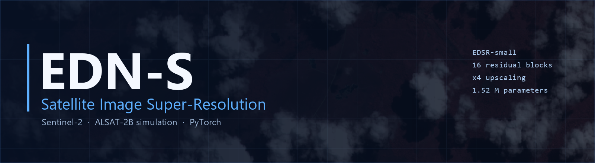
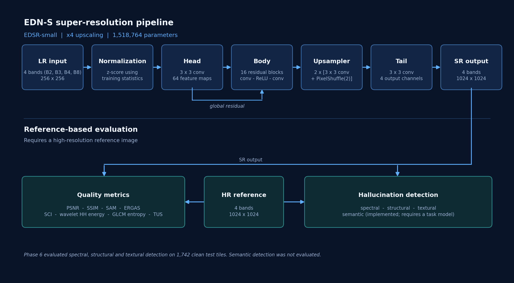
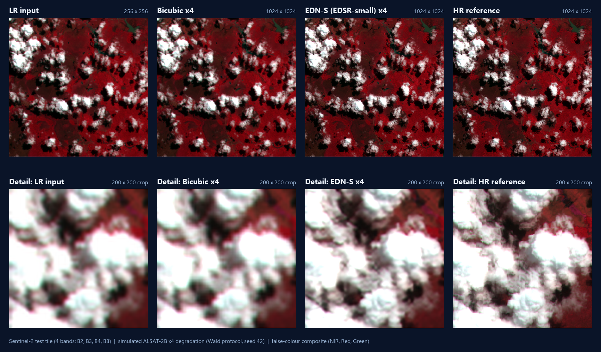
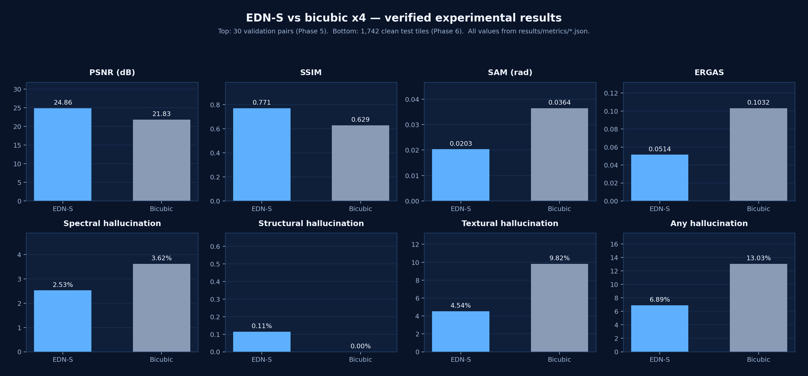

# EDN-S

**Satellite Image Super-Resolution — PyTorch implementation, training and evaluation**

[](https://pypi.org/project/edns/)
[](https://www.python.org/)
[](https://pytorch.org/)
[](LICENSE)
[](#validation)

EDN-S is a PyTorch implementation of an **EDSR-small** super-resolution model for
four-band satellite imagery, packaged with the code needed to train it, reconstruct
images, and evaluate spectral and spatial fidelity. It was developed as an independent
software and experimental project around a proposed research direction on the reliability
of satellite image super-resolution.

The package is installable from PyPI (`pip install edns`) and exposes both a CLI
(`edns-sr`) and a Python API (`run_sr`).

---

## EDN-S and the broader research project

Two things are deliberately kept separate in this repository.

**EDN-S — the software implementation.** The model, training pipeline, configurations,
inference and reconstruction code, evaluation metrics, hallucination-detection
implementation, CLI and Python package. This is what the repository contains and what
the reported experiments were run with.

**The broader research direction.** The scientific investigation described by the title:

> *“Hallucination-Aware and Task-Driven Evaluation of Super-Resolution Methods for
> ALSAT-2B Satellite Imagery.”*

That title describes a research topic proposed as a potential Master’s project. It was
**not officially confirmed or approved** as a Master’s thesis or university project. EDN-S
was continued independently rather than waiting for confirmation. The implementation,
training and experiments reported here are real and were completed; the academic framing
is a proposed, unconfirmed direction, not an approved degree requirement.

EDN-S is therefore **not** presented as a new neural-network architecture. Its model is
an EDSR-small variant adapted to four-channel multi-spectral input. The engineering work
lies in the data pipeline, the ALSAT-2B degradation simulation, the training and
reconstruction workflow, the evaluation suite, and the hallucination-detection tooling.

---

## Contents

- [Status](#status)
- [Overview](#overview)
- [Motivation](#motivation)
- [Objectives](#objectives)
- [Features](#features)
- [Architecture](#architecture)
- [Model implementation](#model-implementation)
- [Dataset](#dataset)
- [Satellite bands](#satellite-bands)
- [Installation](#installation)
- [Quick start](#quick-start)
- [Usage](#usage)
- [Training](#training)
- [Reconstruction workflow](#reconstruction-workflow)
- [Evaluation methodology](#evaluation-methodology)
- [Results](#results)
- [Metrics and interpretation](#metrics-and-interpretation)
- [Project structure](#project-structure)
- [Limitations](#limitations)
- [Reproducibility](#reproducibility)
- [Future work](#future-work)
- [References](#references)
- [Acknowledgements](#acknowledgements)
- [License](#license)
- [Citation](#citation)

---

## Status

| Component | State | Evidence |
|---|---|---|
| EDSR-small model and inference | Implemented | `src/edns/models/edsr.py`, `src/edns/inference/app.py` |
| Training pipeline | Implemented and run | 300 epochs on Kaggle 2× T4; `results/metrics/phase5_train_summary.json` |
| Quality evaluation | Implemented and run | 30 validation pairs; `results/metrics/phase5_edsr_small_eval.json` |
| Hallucination detection (spectral, structural, textural) | Implemented and run | 1,742 test tiles; `results/metrics/phase6_hallucination.json` |
| Hallucination detection (semantic) | Implemented, **not evaluated** | Requires a downstream task model |
| Downstream task evaluation | Framework only | `src/downstream/tasks.py`; no task model was trained |
| SwinIR-base / Real-ESRGAN | Code and configs present, **no completed runs** | `configs/models/` |
| Real ALSAT-2B imagery | **Not available / not used** | All experiments use Sentinel-2 with simulated degradation |
| Unit tests | 246 passing | `python -m pytest tests/ -q` |

---

## Overview

Super-resolution (SR) reconstructs a high-resolution image from a lower-resolution
observation. For satellite imagery the problem is not only visual: a plausible-looking
reconstruction can alter spectral signatures, invent texture, or move structural detail.
EDN-S addresses the engineering side of that problem with:

- a compact four-band SR model that runs on CPU or GPU;
- a reproducible Wald-style degradation pipeline that simulates ALSAT-2B ×4 imagery from
  Sentinel-2;
- a tiled reconstruction path that preserves GeoTIFF georeferencing;
- a metric suite covering fidelity, spectral consistency and texture;
- a reference-based hallucination detector with spectral, structural, textural and
  semantic categories.

## Motivation

Sentinel-2 provides freely available 10 m imagery in the visible and near-infrared bands.
ALSAT-2B provides 2.5 m panchromatic and 10 m multi-spectral imagery, but access is
restricted. A common research strategy is therefore to simulate the lower-resolution
sensor from Sentinel-2 and study SR methods under controlled degradation.

Most SR benchmarks reward pixel fidelity alone. In Earth observation, a reconstruction
that scores well on PSNR can still be unreliable for mapping, change detection or
spectral indices. EDN-S was built to make both sides measurable: reconstruction quality
and the risk of hallucinated content.

## Objectives

1. Implement a compact EDSR-small model for four-band 10 m satellite input at ×4 scale.
2. Build a deterministic ALSAT-2B degradation simulation based on the Wald protocol.
3. Train and evaluate the model against a bicubic baseline on held-out tiles.
4. Provide spectral, structural and textural hallucination checks against an HR reference.
5. Package the reconstruction and evaluation workflow as a reproducible CLI and API.
6. Keep the implementation honest about what was measured, on which data, and with which
   limitations.

---

## Features

- **Four-band input/output** — B2 (blue), B3 (green), B4 (red), B8 (NIR) at 10 m.
- **×4 upscaling** — 256×256 LR tile → 1024×1024 SR tile.
- **1.52 M parameters** — 16 residual blocks, 64 feature channels.
- **Tiled inference** — 256 px tiles with 32 px overlap and weighted blending.
- **GeoTIFF-aware** — preserves the spatial transform and writes a four-band float32 raster.
- **Training pipeline** — L1 loss, AdamW, cosine schedule, mixed precision, checkpointing.
- **Metric suite** — PSNR, MSE, MAE, SSIM, SAM, ERGAS, SCI, wavelet HH energy, GLCM
  entropy, and a task-utility score (TUS).
- **Hallucination detection** — spectral, structural, textural, and a semantic interface
  that requires a task model.
- **CLI and Python API** — `edns-sr` and `run_sr()`.

---

## Architecture



The implemented network follows the EDSR design:

```
LR (4 × H × W)
  → 3×3 conv, 64 channels                     (head)
  → 16 residual blocks: conv–ReLU–conv        (body)
  → global residual addition
  → 2 × [3×3 conv + PixelShuffle(2)]          (upsampler, ×4)
  → 3×3 conv, 4 channels                      (tail)
  → SR (4 × 4H × 4W)
```

There is no batch normalisation, matching the original EDSR design. The model also
contains identity-initialised 1×1 `sub_mean` / `add_mean` convolutions inherited from the
EDSR reference implementation; they are present in the parameter count and checkpoint.

## Model implementation

| Property | Value |
|---|---|
| Architecture | EDSR-small |
| Residual blocks | 16 |
| Feature channels | 64 |
| Upscaling | ×4 (two PixelShuffle stages) |
| Input channels | 4 (B2, B3, B4, B8) |
| Output channels | 4 |
| Parameters | **1,518,764** (≈1.52 M) |
| Normalisation | None (EDSR-style) |
| Residual scaling | 1.0 |

The implementation lives in [`src/edns/models/edsr.py`](src/edns/models/edsr.py). The
research training tree uses the parallel copy in `src/models/edsr.py`; the two are kept
separate for packaging and experimentation (see [Project structure](#project-structure)).

---

## Dataset

The experiments use **Sentinel-2 L2A** imagery as a stand-in for ALSAT-2B. Real ALSAT-2B
scenes were not available for this work, so no ALSAT-2B result is claimed.

| Property | Value |
|---|---|
| Source | Sentinel-2 L2A (Copernicus) |
| Bands | B2, B3, B4, B8 |
| Native resolution | 10 m |
| Areas of interest | 8 |
| Scenes | 87 accepted (one degenerate granule rejected) |
| Tiles | 14,748 at 1024×1024, float32 |
| Splits | 7,968 train / 2,712 val / 4,068 test |
| Normalisation | Train-only z-score statistics, NaN excluded |
| HR | Clean 10 m tile (1024×1024) |
| LR | Wald degradation ×4 (256×256), seed 42 |

The degradation pipeline simulates the ALSAT-2B acquisition chain with a trapezoidal
spectral response, Gaussian MTF, Poisson–Gaussian noise, 12→10-bit quantisation,
sub-pixel shift and area downsampling. Parameters and their provenance are documented in
[`configs/degradation/alsat2b.yaml`](configs/degradation/alsat2b.yaml) and
[`docs/reproducibility.md`](docs/reproducibility.md).

> **Simulated, not real, ALSAT-2B data.** The LR images are generated from Sentinel-2 by
> a degradation model. They approximate the ALSAT-2B setting; they are not ALSAT-2B
> observations.

### Training / validation / test protocol

- Pairs are built only from tiles with `nan_fraction == 0.0`.
- The model is trained on LR/HR patches and evaluated on full 256→1024 tiles.
- Bicubic ×4 is recomputed on the same validation pairs for a fair comparison.
- The test split (4,068 tiles) was kept local and used for the hallucination evaluation;
  1,742 clean test tiles were retained after filtering.

---

## Satellite bands

| Channel | Sentinel-2 band | Name | Wavelength (approx.) | Native resolution |
|---|---|---|---|---|
| 1 | B2 | Blue | 490 nm | 10 m |
| 2 | B3 | Green | 560 nm | 10 m |
| 3 | B4 | Red | 665 nm | 10 m |
| 4 | B8 | NIR | 842 nm | 10 m |

The model operates on surface-reflectance values normalised with training statistics.
Inputs with one or three channels are accepted by the CLI: a single band is repeated to
four channels, and a three-channel input gets an estimated NIR channel
(`(blue + green) / 2`). These fallbacks are conveniences, not validated spectral
reconstructions.

---

## Installation

### From PyPI

```bash
pip install edns
```

### From source

```bash
git clone https://github.com/aimenachraff-jpg/EDN-s.git
cd EDN-s
pip install -e .
```

### Requirements

- Python 3.10 or newer
- PyTorch 2.x (CPU or CUDA)
- `rasterio`, `numpy`, `scipy`, `scikit-image`, `pyyaml`, `omegaconf`, `pillow`,
  `matplotlib`

The development pins are in [`requirements.txt`](requirements.txt); cloud-training
extras are in [`requirements-cloud.txt`](requirements-cloud.txt).

> **Model weights are not distributed on PyPI.** The package contains code only. To run
> inference, provide a checkpoint with `--ckpt` (or `EDNS_CKPT`), or train your own model.
> The checkpoint used for the reported results is `edsr_small_phase5_best.pt`; place it at
> `experiments/checkpoints/edsr_small_phase5_best.pt` or pass its path explicitly.

---

## Quick start

### CLI

```bash
# Basic super-resolution (writes input_sr.tif by default)
edns-sr input.tif --ckpt experiments/checkpoints/edsr_small_phase5_best.pt

# Explicit output path
edns-sr input.tif -o output_sr.tif --ckpt experiments/checkpoints/edsr_small_phase5_best.pt

# With reference-based hallucination detection
edns-sr input.tif \
  --ckpt experiments/checkpoints/edsr_small_phase5_best.pt \
  --hallucination --hr reference_hr.tif --report report.json
```

Environment variables:

| Variable | Purpose |
|---|---|
| `EDNS_CKPT` | Default checkpoint path |
| `EDNS_CONFIG` | Default model configuration path |

### Python API

```python
from edns.inference import run_sr

result = run_sr(
    input_path="input.tif",
    output_path="output_sr.tif",
    ckpt_path="experiments/checkpoints/edsr_small_phase5_best.pt",
)
print(result["output_path"])
```

With hallucination detection (an HR reference is required):

```python
result = run_sr(
    input_path="input.tif",
    output_path="output_sr.tif",
    ckpt_path="experiments/checkpoints/edsr_small_phase5_best.pt",
    compute_hallucination=True,
    hr_reference_path="reference_hr.tif",
    hallucination_report_path="hallucination_report.json",
)
print(result["hallucination_report"]["summary"])
```

---

## Usage

### Input requirements

- GeoTIFF with 4 bands ordered **B2, B3, B4, B8**.
- The reader accepts 1, 3 or 4 bands; see [Satellite bands](#satellite-bands).
- Values are normalised internally with the packaged training statistics.
- NaN pixels (clouds, shadows, voids) are replaced with zero before inference.

### Output

- Four-band float32 GeoTIFF at 4× the input width and height.
- The affine transform is divided by 4 so the output remains georeferenced.
- For a 256×256 input the output is 1024×1024.

### Hallucination report

`--report` writes a JSON document with per-category detections and a summary:

```json
{
  "input_path": "input.tif",
  "output_path": "output_sr.tif",
  "hr_reference_path": "reference_hr.tif",
  "hallucination": {
    "classification": "textural",
    "detected_types": ["textural"],
    "confidences": {"spectral": 0.0123, "structural": 0.0001, "textural": 0.0456, "semantic": 0.0},
    "details": {
      "spectral":   {"detected": false, "confidence": 0.0123},
      "structural": {"detected": false, "confidence": 0.0001},
      "textural":   {"detected": true,  "confidence": 0.0456},
      "semantic":   {"detected": false, "reason": "no_task_model"}
    }
  },
  "summary": {
    "any_hallucination": true,
    "detected_categories": ["textural"],
    "max_confidence": 0.0456
  }
}
```

> Hallucination detection is **reference-based**: it compares the SR output with a
> high-resolution reference. It is not a reference-free quality estimator.

---

## Training

Training is performed with the research tree (`src/training/trainer.py`) and the model
configuration in [`configs/models/edsr_small.yaml`](configs/models/edsr_small.yaml).

### Configuration used for the reported run

| Setting | Value |
|---|---|
| Model | EDSR-small (16 blocks, 64 features, ×4) |
| Batch size | 16 |
| Patch size | 48×48 |
| Optimiser | AdamW |
| Learning rate | 1e-4, cosine annealing to 1e-6 |
| Loss | L1 |
| Epochs | 300 |
| Mixed precision | fp16 AMP |
| Gradient clipping | 1.0 |
| Seed | 42 |
| Hardware | Kaggle 2× T4 (GPU 0) |
| Training time | 6.82 h (78,020 steps) |
| Best validation PSNR | 25.169 dB (patch-level, epoch 239) |

### Minimal training loop

```python
import torch
from torch.utils.data import DataLoader
from src.models.edsr import EDSR
from src.training.trainer import SRTrainer, SRDataset, get_model_config, TrainingConfig

train_ds = SRDataset("data/interim/pairs/train/lr", "data/interim/pairs/train/hr",
                     patch_size=48, scale=4)
val_ds = SRDataset("data/interim/pairs/val/lr", "data/interim/pairs/val/hr",
                   patch_size=48, scale=4)

train_loader = DataLoader(train_ds, batch_size=16, shuffle=True, num_workers=4)
val_loader = DataLoader(val_ds, batch_size=1, shuffle=False)

model = EDSR(n_resblocks=16, n_feats=64, scale=4, in_channels=4, out_channels=4)
config = get_model_config("edsr", TrainingConfig())

trainer = SRTrainer(
    model=model,
    config=config,
    train_loader=train_loader,
    val_loader=val_loader,
    device="cuda" if torch.cuda.is_available() else "cpu",
    use_mlflow=False,
)
trainer.train()
```

The Kaggle execution template is in
[`experiments/protocols/kaggle_train_template.py`](experiments/protocols/kaggle_train_template.py).
The dataset preparation scripts are in [`scripts/`](scripts/) (`prepare_pairs.py`,
`generate_tiles.py`, `sentinel2_full.py`).

> The training pipeline supports SwinIR and Real-ESRGAN configurations, but no completed
> runs for those models are included in this repository. Only EDSR-small results are
> reported.

---

## Reconstruction workflow

1. **Read** the LR GeoTIFF and its profile.
2. **Normalise** each band with the training statistics (z-score by default).
3. **Pad** the array to a multiple of the 256 px tile size using reflect padding.
4. **Tile** the input with 32 px overlap.
5. **Run** each tile through the model (×4 output).
6. **Blend** overlapping output regions with linear weights.
7. **Crop** back to exactly 4× the original dimensions.
8. **Write** a four-band float32 GeoTIFF with the adjusted affine transform.

This path is implemented in `SRInference.run_tiled()` and `SRInference.save()` in
[`src/edns/inference/app.py`](src/edns/inference/app.py).

---

## Evaluation methodology

Evaluation is reference-based. Two families of checks are used.

### Quality metrics

Computed against the HR reference with `edns.evaluation.metrics`:

| Metric | What it measures | Better |
|---|---|---|
| PSNR | Pixel-level fidelity (dB) | Higher |
| MSE / MAE | Absolute reconstruction error | Lower |
| SSIM | Local structural similarity | Higher |
| SAM | Spectral angle between band vectors (rad) | Lower |
| ERGAS | Relative global spectral error | Lower |
| SCI | Spectral consistency index | Higher (≈1) |
| Wavelet HH energy | High-frequency detail energy | Context-dependent |
| GLCM entropy | Texture complexity | Context-dependent |
| TUS | Task utility score (composite) | Higher |

### Hallucination detection

`HallucinationDetector.detect_all(sr, hr)` compares the SR output with the HR reference
and reports four categories:

| Category | Signal |
|---|---|
| Spectral | Band-correlation and SAM deviations against the reference |
| Structural | Edge/geometry disagreement and ringing artefacts |
| Textural | GLCM/entropy anomalies relative to the reference |
| Semantic | Downstream task disagreement (requires a task model) |

The detector also includes an annotation protocol, Fleiss’ κ computation and a metric
validation helper for human-label studies. In the reported experiments, only spectral,
structural and textural detection were run; semantic detection requires a task model that
was not trained.

---

## Results

All numbers below come from the JSON files in [`results/metrics/`](results/metrics/).
No value is estimated or extrapolated.

### Visual comparison



The example is a Sentinel-2 test tile with simulated ALSAT-2B ×4 degradation, shown as a
false-colour composite (NIR, Red, Green). The second row shows a 200×200 detail crop.

### Quality: EDN-S vs bicubic ×4

30 validation pairs, full-tile evaluation (256→1024):

| Metric | EDN-S (EDSR-small) | Bicubic ×4 | Difference |
|---|---|---|---|
| PSNR (dB) | **24.8645** | 21.8329 | **+3.0316** |
| SSIM | **0.7709** | 0.6285 | +0.1423 |
| MSE | **0.00329** | 0.00659 | −0.00330 |
| MAE | **0.0370** | 0.0552 | −0.0182 |
| ERGAS | **0.0514** | 0.1032 | −0.0517 |
| SAM (rad) | **0.0203** | 0.0364 | −0.0161 |



### Hallucination rate

1,742 clean test tiles:

| Category | EDN-S | Bicubic ×4 | Difference (pp) |
|---|---|---|---|
| Spectral | **2.53%** | 3.62% | −1.09 |
| Structural | 0.11% | **0.00%** | +0.11 |
| Textural | **4.54%** | 9.82% | −5.28 |
| **Any** | **6.89%** | 13.03% | **−6.14** |

The structural category favours bicubic by a small margin (2 tiles vs 0). The overall
rate and the textural rate favour EDN-S.

### Statistical analysis

From `results/metrics/phase8_statistical_analysis.json`:

- PSNR difference: **+3.03 dB**, Cohen’s d ≈ **6.19**.
- McNemar tests: textural **p < 0.001**, spectral **p < 0.001**, structural
  **p = 0.48** (not significant).
- Confidence intervals are reported per category in the JSON file.

> The PSNR test uses summary statistics because per-pair PSNR values were not saved;
> it is therefore a conservative approximation, as noted in the result file.

---

## Metrics and interpretation

- **PSNR** is easy to compare but weakly correlated with perceptual or spectral realism.
  A higher PSNR does not by itself prove that a reconstruction is trustworthy.
- **SSIM** captures local structure and is less sensitive to global brightness offsets.
- **SAM** measures the angle between spectral vectors; lower values indicate that the
  spectral shape is preserved.
- **ERGAS** aggregates relative error across bands and is sensitive to both spatial and
  spectral error.
- **SCI** summarises band-wise correlation with the reference; values near 1 indicate
  consistent spectral relationships.
- **Wavelet HH energy** and **GLCM entropy** describe high-frequency and texture content.
  They are diagnostic, not automatically “better when higher”: the correct value depends
  on the reference scene.
- **TUS** combines task-relevant signals into a single score; it is implemented as a
  heuristic and should be read alongside the individual metrics.

---

## Project structure

```
EDN-s/
├── configs/                  Model and degradation configurations
│   ├── degradation/          ALSAT-2B Wald simulation parameters
│   └── models/               EDSR, SwinIR, Real-ESRGAN configs
├── docs/                     Guides, phase reports and audit
│   └── assets/               Banner, architecture, gallery, charts
├── experiments/              Training templates, logs and checkpoints
├── research/                 Literature review and methodology notes
├── results/                  Verified metrics, tables and predictions
│   ├── metrics/              JSON result files
│   └── tables/               Markdown summaries
├── scripts/                  Data preparation, training and evaluation scripts
├── src/
│   ├── edns/                 Installable package (CLI + Python API)
│   │   ├── models/           EDSR implementation
│   │   ├── inference/        Tiled inference and CLI
│   │   ├── data/             GeoTIFF I/O and normalisation
│   │   ├── evaluation/       Metric suite
│   │   ├── hallucination/    Reference-based detection
│   │   └── utils/            Logging and helpers
│   ├── models/               Research training models
│   ├── training/             SRTrainer and losses
│   ├── preprocessing/        Tiling, buffers, normalisation
│   ├── degradation/          ALSAT-2B degradation engine
│   ├── downstream/           Downstream task framework
│   └── evaluation/           Research metric implementation
└── tests/                    246 unit tests
```

### Two code trees

The repository intentionally contains two trees:

- **`src/edns/`** is the installable package. It is self-contained and is what
  `pip install edns` ships.
- **`src/models/`, `src/training/`, `src/preprocessing/`, …** are the research and
  training tree used to produce the experiments.

The packaged copies are a curated subset. When changing model code, check both trees and
keep the shared behaviour consistent.

---

## Limitations

1. **No real ALSAT-2B data.** All experiments use Sentinel-2 with simulated ALSAT-2B
   degradation. No claim is made about performance on actual ALSAT-2B scenes.
2. **The degradation is a model, not the sensor.** MTF, noise and SRF parameters are
   estimates or documented approximations; they do not reproduce the full ALSAT-2B
   acquisition chain.
3. **Hallucination detection is reference-based.** It requires an HR reference and cannot
   certify an image in the absence of one.
4. **Semantic hallucination was not evaluated.** The interface exists, but no downstream
   task model was trained.
5. **Downstream task evaluation is a framework only.** No task-driven results are claimed.
6. **Single training run.** The reported model is one seed (42); run-to-run variance was
   not measured.
7. **Small validation set.** Quality metrics use 30 validation pairs; the confidence
   intervals reflect that size.
8. **Structural hallucination favours bicubic** by a small margin (0.11% vs 0.00%).
   This is reported rather than hidden.
9. **PSNR significance is approximate.** Per-pair values were not saved, so the test uses
   summary statistics.
10. **SwinIR and Real-ESRGAN are not benchmarked here.** Their code and configs exist, but
    no completed results are included.

---

## Reproducibility

- **Seeds:** 42 for data splits, degradation noise and training.
- **Configs:** [`configs/models/edsr_small.yaml`](configs/models/edsr_small.yaml),
  [`configs/degradation/alsat2b.yaml`](configs/degradation/alsat2b.yaml).
- **Hardware:** Kaggle 2× T4 for training; CPU (Intel Iris Xe) for local inference and
  hallucination detection.
- **Environment:** Python 3.10, PyTorch 2.3 (local CPU) / 2.x (Kaggle).
- **Result files:** every reported number is stored in `results/metrics/`.
- **Tests:** `python -m pytest tests/ -q` → 246 passed.

A fuller provenance note, including dataset counts and degradation parameters, is in
[`docs/reproducibility.md`](docs/reproducibility.md). The repository audit is in
[`docs/repository_audit.md`](docs/repository_audit.md).

---

## Future work

- Evaluate semantic hallucination with a trained downstream task model.
- Complete the downstream task benchmark (classification, segmentation, change detection).
- Train and compare SwinIR-base and Real-ESRGAN under the same protocol.
- Obtain real ALSAT-2B imagery and repeat the evaluation without simulation.
- Run multiple seeds and report variance.
- Expand the validation set and save per-pair metrics for exact paired tests.
- Add a human annotation study using the implemented protocol.
- Package a reference checkpoint as a release asset.

---

## References

1. Lim, B., Son, S., Kim, H., Nah, S., & Lee, K. M. (2017). *Enhanced Deep Residual
   Networks for Single Image Super-Resolution.* CVPR Workshops.
2. Wang, Z., Bovik, A. C., Sheikh, H. R., & Simoncelli, E. P. (2004). *Image Quality
   Assessment: From Error Visibility to Structural Similarity.* IEEE Transactions on
   Image Processing, 13(4).
3. Kruse, F. A., et al. (1993). *The Spectral Image Processing System (SIPS) — Interactive
   Visualization and Analysis of Imaging Spectrometer Data.* Remote Sensing of
   Environment, 44(2–3).
4. Wald, L., Ranchin, T., & Mangolini, M. (1997). *Fusion of Satellite Images of Different
   Spatial Resolutions: Assessing the Quality of Resulting Images.* Photogrammetric
   Engineering & Remote Sensing, 63(6).
5. Drusch, M., et al. (2012). *Sentinel-2: ESA’s Optical High-Resolution Mission for GMES
   Operational Services.* Remote Sensing of Environment, 120.
6. Blau, Y., & Michaeli, T. (2018). *The Perception-Distortion Tradeoff.* CVPR.

---

## Acknowledgements

- Sentinel-2 data: Copernicus / European Space Agency.
- ALSAT-2B is a mission of the Algerian Space Agency (ASAL). This project is
  **not affiliated with, endorsed by, or conducted in partnership with ASAL**; the mission
  is referenced only as the application context that motivated the degradation model.
- Open-source software: PyTorch, NumPy, SciPy, scikit-image, rasterio, Matplotlib.
- Kaggle for GPU compute used in training.

---

## License

MIT License. See [LICENSE](LICENSE).

## Citation

If you use this code or the evaluation tooling, see [CITATION.cff](CITATION.cff) for the
preferred citation format.

---

### Validation

The following commands were run in the repository before publication:

```bash
python -m pytest tests/ -q
# 246 passed, 1 warning in 36.30s

python -c "import edns; print(edns.__version__)"
# 1.0.2
```

All code examples in this README use the public API signatures in
`src/edns/inference/app.py`, `src/edns/hallucination/detection.py` and
`src/edns/evaluation/metrics.py`.
